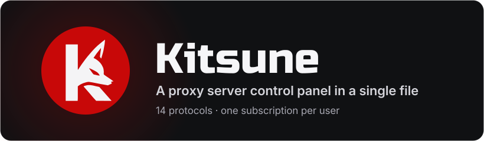
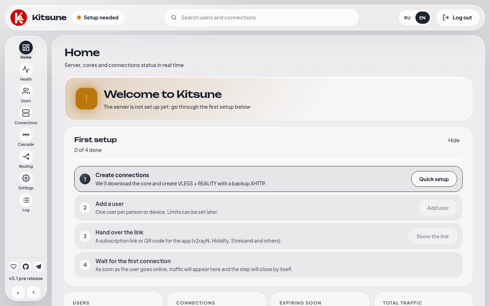

<div align="center">



Kitsune is a control panel for a private proxy server on a Linux VPS. Configure connections, manage subscriptions, and monitor server health from your browser.

<p>
<a href="CHANGELOG.md"></a>
<a href="LICENSE"></a>
<a href="#protocols"></a>
<a href="go.mod"></a>
<a href="https://donate.itsnotkubrick.dev"></a>
</p>

[**Quick start**](#quick-start) · [**Features**](#features) · [**Protocols**](#protocols) · [**Management**](#management)

<p>
<a href="README.md"></a>
<a href="README.en.md"></a>
</p>

</div>

> [!IMPORTANT]
> **This project is open-source software.** It does not provide communication services or access to servers.
> You install it on your own server and are responsible for complying with the laws of your country.
> The project is made for educational purposes.

## Quick start

You need a Linux VPS (x86_64 or arm64) with `systemd`, `root` access over SSH, and at least 1 GB of RAM. Use 2 GB or more if you plan to run all connection types together.

Connect to the server over SSH and run the installer.

```bash
bash <(curl -fsSL https://github.com/itsnotkubrick/Kitsune/releases/latest/download/install.sh) install
```

While the repository is private, sign in to GitHub, download the installer from Latest Release, and transfer it to the VPS. Save a token with Contents: Read access to Kitsune only in `/etc/kitsune/github-token` (root-owned, mode `0600`). The panel uses the same file to check for updates.


1. **Sign in.** Open the panel URL printed by the installer and sign in with the credentials it generated.
2. **Change your password.** Update the initial password under **Settings → Security**.
3. **Share a subscription.** If no connections exist yet, use the setup wizard to create them. Under **Users**, select or create a user and copy their HTTPS subscription URL.

<details>
<summary>Certificates, ports, and installation options</summary>

- **With a domain.** Point its A record to the server's public IP address. Port `80/tcp` must be reachable for Let's Encrypt HTTP validation.
- **Without a domain.** Select a certificate for the public IP address. If issuance fails, the installer offers a self-signed certificate.
- **Ports.** Check your hosting firewall rules for the panel's HTTP port (`8080` by default), the selected HTTPS port, and the connection ports. The installer lists them at the end.
- **BBR.** Pass `--bbr` or `--no-bbr` to set this explicitly. Run `kit bbr status` to check the current setting.
- **When upgrading.** If panel HTTPS is enabled, replace saved HTTP subscription URLs with the HTTPS URLs shown in the panel.

</details>

<p align="center">
  
</p>

## Features

###  Users and subscriptions

- Set expiry dates, shared traffic quotas, and device limits. Manage access groups and templates.
- Give each user a single URL. The panel selects a profile format and connections compatible with the client app.

###  Connections and routing

- Choose from 14 connection types. Install and update networking cores from the panel.
- Set routing rules for local networks and selected apps. Generate profiles for Keenetic (XKeen) and OpenWrt (Nikki).
- Configure load balancing, fallback routes, and forwarding between your own nodes.

###  Diagnostics

- Check core health, ports, and TLS, with a history of results.
- Measure connection quality from the client side and verify connectivity to your own server.

###  Administration

- Two-factor sign-in (TOTP), HTTPS, and panel access over an SSH tunnel.
- Encrypted backups and restore.
- A web panel, the `kit` command, and a Telegram bot for administrators.

## Protocols

<div align="center">
<table align="center">
  <thead>
    <tr><th align="center">Protocol</th><th align="center">Core</th><th align="center">Transport</th></tr>
  </thead>
  <tbody>
    <tr><td align="center">VLESS + REALITY</td><td align="center">Xray</td><td align="center">TCP</td></tr>
    <tr><td align="center">VLESS + XHTTP + REALITY</td><td align="center">Xray</td><td align="center">TCP</td></tr>
    <tr><td align="center">VLESS + WebSocket + TLS</td><td align="center">Xray</td><td align="center">TCP</td></tr>
    <tr><td align="center">Trojan + gRPC + TLS</td><td align="center">Xray</td><td align="center">TCP</td></tr>
    <tr><td align="center">VMess + WebSocket + TLS</td><td align="center">Xray</td><td align="center">TCP</td></tr>
    <tr><td align="center">Shadowsocks 2022</td><td align="center">Xray</td><td align="center">TCP + UDP</td></tr>
    <tr><td align="center">Hysteria 2</td><td align="center">Xray</td><td align="center">UDP</td></tr>
    <tr><td align="center">TUIC v5</td><td align="center">sing-box</td><td align="center">UDP</td></tr>
    <tr><td align="center">NaiveProxy</td><td align="center">sing-box</td><td align="center">TCP</td></tr>
    <tr><td align="center">Mieru</td><td align="center">mita</td><td align="center">TCP / UDP</td></tr>
    <tr><td align="center">MTProto</td><td align="center">mtg</td><td align="center">TCP</td></tr>
    <tr><td align="center">MASQUE (CONNECT-IP)</td><td align="center">sing-box</td><td align="center">UDP + TCP</td></tr>
    <tr><td align="center">AmneziaWG</td><td align="center">Built in</td><td align="center">UDP</td></tr>
    <tr><td align="center">AmneziaWG 3.1</td><td align="center">Built in</td><td align="center">UDP</td></tr>
  </tbody>
</table>
</div>

- **AmneziaWG 3.1.** Supported by AmneziaVPN ≥ 5.0.1.5, Keenetic OS ≥ 5.2 Alpha 11, and Mihomo ≥ 1.19.30. Earlier clients can use standard AmneziaWG.
- **MASQUE.** Experimental connection type supported by sing-box ≥ 1.15 and Xray ≥ 26.10.10. Download the client configuration from the user's Links section. Traffic is counted per connection.
- **NaiveProxy.** Requires a domain with a Let's Encrypt certificate.

## Management

Run `kit` on the server to open the interactive menu. Common commands:

<div align="center">
<table align="center">
  <thead>
    <tr><th align="center">Command</th><th align="center">Action</th></tr>
  </thead>
  <tbody>
    <tr><td align="center"><code>kit status</code></td><td align="center">Show service status and the panel URL</td></tr>
    <tr><td align="center"><code>kit log</code></td><td align="center">Show recent logs</td></tr>
    <tr><td align="center"><code>kit update</code></td><td align="center">Update Kitsune</td></tr>
    <tr><td align="center"><code>kit help</code></td><td align="center">List commands</td></tr>
  </tbody>
</table>
</div>

Enable the Telegram bot under **Settings → Notifications**.

## Support the project

**Need a VPS?** I use **[IS Hosting](https://ishosting.io/affiliate/NTg4MiM4)** myself and recommend it (referral link: you get a server, the project receives a referral commission).

Kitsune is free and open source. Support is voluntary: it pays for test servers
and keeps the panel up to date. Thank you! 💜

<p align="center"><a href="https://donate.itsnotkubrick.dev"></a></p>

## License

Kitsune is distributed under the **GNU General Public License v3.0** (full text in [LICENSE](LICENSE)). You may use, modify and redistribute it provided derived versions stay open under the same terms. The software comes with no warranty.

## Acknowledgements

Kitsune is built on the work of the authors of these projects:
[Xray-core](https://github.com/XTLS/Xray-core) ·
[sing-box](https://github.com/SagerNet/sing-box) ·
[mtg](https://github.com/9seconds/mtg) ·
[Mieru](https://github.com/enfein/mieru) ·
[AmneziaWG](https://github.com/amnezia-vpn/amneziawg-go) ·
[lego](https://github.com/go-acme/lego) ·
[Gin](https://github.com/gin-gonic/gin) ·
[XKeen](https://github.com/jameszeroX/XKeen)
