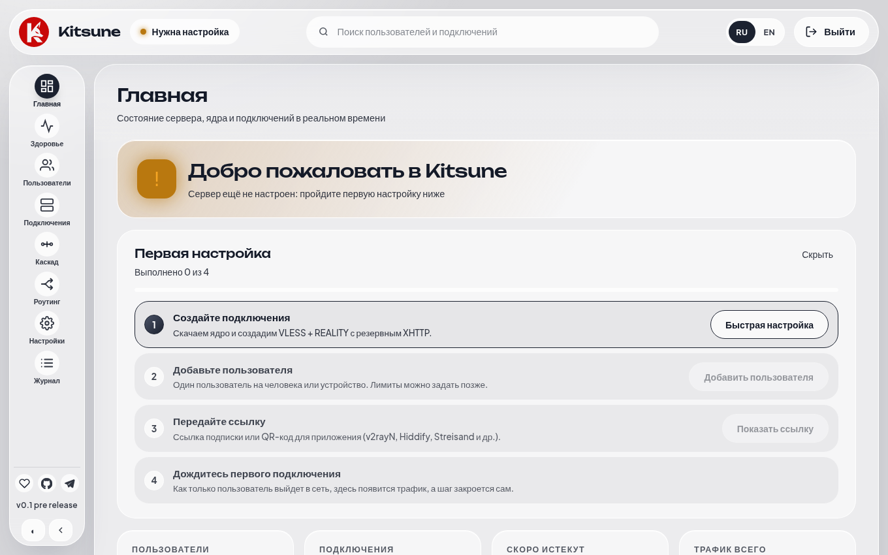

<div align="center">


Kitsune — панель управления частным прокси-сервером на Linux VPS. Настраивайте подключения, выдавайте подписки и следите за состоянием сервера из браузера.

<p>
<a href="CHANGELOG.md"></a>
<a href="LICENSE"></a>
<a href="#поддерживаемые-сетевые-протоколы"></a>
<a href="go.mod"></a>
<a href="https://donate.itsnotkubrick.dev"></a>
</p>

[**Быстрый старт**](#быстрый-старт) · [**Возможности**](#возможности) · [**Протоколы**](#поддерживаемые-сетевые-протоколы) · [**Управление**](#управление)

<p>
<a href="README.md"></a>
<a href="README.en.md"></a>
</p>

</div>

> [!IMPORTANT]
> **Правовая информация и отказ от ответственности**  
> Настоящее программное обеспечение с открытым исходным кодом разработано исключительно в исследовательских, демонстрационных и образовательных целях для системного администрирования, автоматизации инфраструктуры и защиты сетевого трафика в приватных сетях. Проект **не оказывает услуг связи**, не предоставляет вычислительных мощностей и не содержит предустановленных сетевых шлюзов. Развертывание осуществляется пользователем на собственном оборудовании под личную ответственность за соблюдение применимого законодательства.

## Быстрый старт

Понадобится Linux VPS (x86_64 или arm64) с `systemd`, доступом `root` по SSH и минимум 1 ГБ RAM. Для одновременного запуска всех подключений рекомендуется от 2 ГБ.

Для публичного репозитория запустите установщик на сервере. Нужны Python 3, curl и ssh-keygen.

```bash
bash <(curl -fsSL https://github.com/itsnotkubrick/Kitsune/releases/latest/download/install.sh) install
```

Пока репозиторий приватный, скачайте установщик из Latest Release через GitHub под своей учётной записью и перенесите его на VPS. Для загрузки файлов релиза сохраните токен с правами Contents: Read только для Kitsune в `/etc/kitsune/github-token` (права `0600`, владелец root). Этот же файл использует панель для проверки обновлений.


1. **Войдите в панель.** Откройте адрес панели, который покажет установщик, и войдите с выданными учётными данными.
2. **Смените пароль.** Обновите стартовый пароль в разделе **Настройки → Безопасность**.
3. **Выдайте подписку.** Если подключений ещё нет, создайте их через мастер. В разделе **Пользователи** выберите или создайте пользователя и скопируйте HTTPS-ссылку подписки.

<details>
<summary>Сертификаты, порты и параметры установки</summary>

- **С доменом.** Направьте A-запись на публичный IP сервера. Для выпуска сертификата Let's Encrypt через HTTP нужен доступный порт `80/tcp`.
- **Без домена.** Выберите сертификат для публичного IP. Если его выпуск не удастся, установщик предложит самоподписанный сертификат.
- **Порты.** Проверьте правила файрвола хостинга для HTTP-порта панели (по умолчанию `8080`), выбранного HTTPS-порта и портов подключений. Установщик выведет их в конце.
- **BBR.** Для явного выбора передайте установщику `--bbr` или `--no-bbr`. Текущее состояние можно посмотреть командой `kit bbr status`.
- **При обновлении.** Если HTTPS панели включён, замените сохранённые HTTP-ссылки подписок на HTTPS-ссылки из панели.

</details>

<p align="center">
  
</p>

## Возможности

###  Пользователи и подписки

- Управление сроком доступа, общим лимитом трафика и числом устройств. Группы доступа и шаблоны.
- Одна ссылка на пользователя. Панель подбирает формат профиля и совместимые подключения для клиентского приложения.

###  Подключения и маршрутизация

- Поддержка 14 типов подключений. Сетевые ядра устанавливаются и обновляются из панели.
- Правила для локальных сетей и выбранных приложений, профили для Keenetic (XKeen) и OpenWrt (Nikki).
- Балансировка, резервные маршруты и каскад между собственными узлами.

###  Диагностика

- Проверки состояния ядер, портов и TLS с историей результатов.
- Тест качества связи со стороны клиента и проверка подключения к собственному серверу.

###  Администрирование

- Двухфакторный вход (TOTP), HTTPS и доступ к панели через SSH-туннель.
- Резервные копии с шифрованием и восстановление.
- Веб-панель, консоль `kit` и Telegram-бот для администраторов.

## Поддерживаемые сетевые протоколы

<div align="center">
<table align="center">
  <thead>
    <tr><th align="center">Протокол</th><th align="center">Ядро</th><th align="center">Транспорт</th></tr>
  </thead>
  <tbody>
    <tr><td align="center">VLESS + REALITY</td><td align="center">Xray</td><td align="center">TCP</td></tr>
    <tr><td align="center">VLESS + XHTTP + REALITY</td><td align="center">Xray</td><td align="center">TCP</td></tr>
    <tr><td align="center">VLESS + WebSocket + TLS</td><td align="center">Xray</td><td align="center">TCP</td></tr>
    <tr><td align="center">Trojan + gRPC + TLS</td><td align="center">Xray</td><td align="center">TCP</td></tr>
    <tr><td align="center">VMess + WebSocket + TLS</td><td align="center">Xray</td><td align="center">TCP</td></tr>
    <tr><td align="center">Shadowsocks 2022</td><td align="center">Xray</td><td align="center">TCP + UDP</td></tr>
    <tr><td align="center">Hysteria 2</td><td align="center">Xray</td><td align="center">UDP</td></tr>
    <tr><td align="center">TUIC v5</td><td align="center">sing-box</td><td align="center">UDP</td></tr>
    <tr><td align="center">NaiveProxy</td><td align="center">sing-box</td><td align="center">TCP</td></tr>
    <tr><td align="center">Mieru</td><td align="center">mita</td><td align="center">TCP / UDP</td></tr>
    <tr><td align="center">MTProto</td><td align="center">mtg</td><td align="center">TCP</td></tr>
    <tr><td align="center">MASQUE (CONNECT-IP)</td><td align="center">sing-box</td><td align="center">UDP + TCP</td></tr>
    <tr><td align="center">AmneziaWG</td><td align="center">Встроено</td><td align="center">UDP</td></tr>
    <tr><td align="center">AmneziaWG 3.1</td><td align="center">Встроено</td><td align="center">UDP</td></tr>
  </tbody>
</table>
</div>

- **AmneziaWG 3.1.** Поддерживается в AmneziaVPN ≥ 5.0.1.5, Keenetic OS ≥ 5.2 Alpha 11 и Mihomo ≥ 1.19.30. Для более ранних клиентов доступен стандартный AmneziaWG.
- **MASQUE.** Экспериментальное подключение, поддерживается в sing-box ≥ 1.15 и Xray ≥ 26.10.10. Готовый клиентский конфиг находится в разделе «Ссылки» пользователя. Трафик учитывается по подключению.
- **NaiveProxy.** Нужен домен с сертификатом Let's Encrypt.

## Управление

Запустите `kit` на сервере, чтобы открыть интерактивное меню. Часто используемые команды:

<div align="center">
<table align="center">
  <thead>
    <tr><th align="center">Команда</th><th align="center">Действие</th></tr>
  </thead>
  <tbody>
    <tr><td align="center"><code>kit status</code></td><td align="center">Состояние службы и адрес панели</td></tr>
    <tr><td align="center"><code>kit log</code></td><td align="center">Последние записи журнала</td></tr>
    <tr><td align="center"><code>kit update</code></td><td align="center">Обновление Kitsune</td></tr>
    <tr><td align="center"><code>kit help</code></td><td align="center">Список команд</td></tr>
  </tbody>
</table>
</div>

Telegram-бот включается в разделе **Настройки → Уведомления**.

## Поддержать проект

**Нужен VPS?** Я сам использую [**IS Hosting**](https://ishosting.io/affiliate/NTg4MiM4) и рекомендую его (партнерская ссылка: поддержка проекта без дополнительных затрат).

Kitsune — бесплатный проект с открытым исходным кодом. Ваша поддержка помогает развивать функциональность и оплачивать тестовые стенды:

<p align="center"><a href="https://donate.itsnotkubrick.dev"></a></p>

---

## Лицензия

Kitsune распространяется по лицензии **GNU General Public License v3.0** (полный текст в файле [LICENSE](LICENSE)). Вы можете использовать, изменять и распространять программу при условии, что производные версии остаются открытыми на тех же условиях. Программа поставляется без каких-либо гарантий.

---

## Благодарности

Kitsune построена на базе разработок сообщества open-source:
[Xray-core](https://github.com/XTLS/Xray-core) ·
[sing-box](https://github.com/SagerNet/sing-box) ·
[mtg](https://github.com/9seconds/mtg) ·
[Mieru](https://github.com/enfein/mieru) ·
[AmneziaWG](https://github.com/amnezia-vpn/amneziawg-go) ·
[lego](https://github.com/go-acme/lego) ·
[Gin](https://github.com/gin-gonic/gin) ·
[XKeen](https://github.com/jameszeroX/XKeen)
